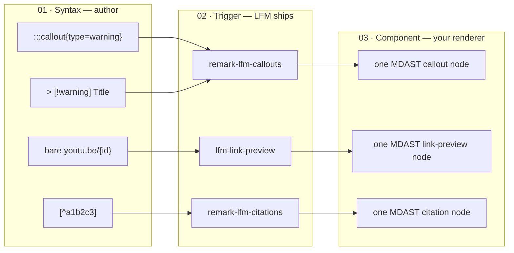

# @lossless-group/lfm

**Lossless Flavored Markdown** — MDX power without MDX's opinions.

LFM turns many markdown authoring conventions (CommonMark, GFM, directives, Obsidian callouts, hex-code citations) into one AST for your framework's components to render. If you want JSX in markdown, use MDX. If you want CommonMark only, use `remark-parse`. LFM sits between them.

[Live demo](https://lossless-group.github.io/lossless-flavored-markdown-package/demo/) · [Site](https://lossless-group.github.io/lossless-flavored-markdown-package/) · [Changelog](https://lossless-group.github.io/lossless-flavored-markdown-package/changelog/) · [Docs](https://github.com/lossless-group/lossless-flavored-markdown-package/tree/master/docs-v)

## Install

Install from [JSR](https://jsr.io/@lossless-group/lfm) with an npm alias:

```jsonc
// package.json
{
  "dependencies": {
    "@lossless-group/lfm": "npm:@jsr/lossless-group__lfm@^0.7.0"
  }
}
```

```ini
# .npmrc
@jsr:registry=https://npm.jsr.io
```

Newer pnpm versions can use `"@lossless-group/lfm": "jsr:^0.7.0"` instead, with no `.npmrc` line. [GitHub Packages](https://github.com/lossless-group/lossless-flavored-markdown-package/pkgs/npm/lfm) also carries a mirror, but it needs an auth token.

## Quick start

```ts
import { parseMarkdown } from '@lossless-group/lfm';

const tree = await parseMarkdown(markdownContent);
// tree is an MDAST. Your renderer maps its nodes to components.
```

To add LFM to an existing `unified` pipeline, use the preset:

```ts
import { unified } from 'unified';
import remarkParse from 'remark-parse';
import { remarkLfm } from '@lossless-group/lfm';

const processor = unified().use(remarkParse).use(remarkLfm);
const tree = await processor.run(processor.parse(content));
```

Every plugin is also exported on its own, for example `remarkLfmCallouts`.

## What you can write

| You want | You write | Setup | Guide |
|---|---|---|---|
| Tables, task lists, strikethrough, autolinks | GFM | On by default | |
| Callouts | `> [!warning] Title` or `:::callout{type="warning"}` | On by default | |
| Citations | `[^a1b2c3]` | On by default | [Citations](https://github.com/lossless-group/lossless-flavored-markdown-package/blob/master/docs-v/citations.md) |
| Heading anchors and a table of contents | Any heading | On by default | [Headings](https://github.com/lossless-group/lossless-flavored-markdown-package/blob/master/docs-v/headings.md) |
| An eyebrow and subheading on a heading | `$$ Eyebrow` and `&& Subheading` | On by default | [Headings](https://github.com/lossless-group/lossless-flavored-markdown-package/blob/master/docs-v/headings.md) |
| Link previews | `:::link-preview` or `:::link-rollup` | On by default; fetching metadata needs `ogFetch` | [Link previews](https://github.com/lossless-group/lossless-flavored-markdown-package/blob/master/docs-v/link-previews.md) |
| Image carousels | `:::image-carousel` | On by default | [Image carousels](https://github.com/lossless-group/lossless-flavored-markdown-package/blob/master/docs-v/images.md) |
| Mermaid diagrams | A `mermaid` code fence | Register the format; your site draws it with mermaid.js | [Code fences](https://github.com/lossless-group/lossless-flavored-markdown-package/blob/master/docs-v/code-fences.md#mermaid) |
| Graphviz, PlantUML, Vega-Lite, YANG, JSON Schema, JSON Canvas | A code fence named for the format | Register the format | [Code fences](https://github.com/lossless-group/lossless-flavored-markdown-package/blob/master/docs-v/code-fences.md) |
| Colored code | Any code fence | Import `/highlight` in your code block component | [Highlighting](https://github.com/lossless-group/lossless-flavored-markdown-package/blob/master/docs-v/highlighting.md) |
| Wikilinks | `[[Page]]` or `[[folder/Page#Section\|Display]]` | Supply a resolver or path config | [Wikilinks](https://github.com/lossless-group/lossless-flavored-markdown-package/blob/master/docs-v/wikilinks.md) |
| Task metadata | `- [ ] @handle Title #Tag ~3d 2026-11-15` | Set `taskMetadata` | [Tasks](https://github.com/lossless-group/lossless-flavored-markdown-package/blob/master/docs-v/tasks.md) |

A bare URL on its own line can also become an embed. The provider catalog ships now, but sites classify the URLs themselves until the plugin lands. See [Link previews](https://github.com/lossless-group/lossless-flavored-markdown-package/blob/master/docs-v/link-previews.md).

## How it works

Authors keep writing in whatever syntax their tool prefers. A `remark` plugin matches the pattern (the *trigger*), and the parser emits one canonical node for your renderer.



A directive callout and an Obsidian callout produce the same node, so your `<Callout>` renders one shape whichever tool wrote the file. Supporting a new syntax means adding a plugin, with no renderer changes. This package owns the first two stages, and the components are yours.

## Options

```ts
const tree = await parseMarkdown(content, {
  gfm: true,            // default: true
  directives: true,     // default: true; also enables link previews and carousels
  callouts: true,       // default: true
  citations: true,      // default: true
  headingIds: true,     // default: true
  headingBlocks: true,  // default: true

  // Opt-in, because each needs something from you:
  // codeFences: { formats: [mermaid] },
  // wikilinks: { resolver },
  // taskMetadata: true,
  // ogFetch: { enabled: true },     // makes network calls
});
```

## Imports

| Import | Contains |
|---|---|
| `@lossless-group/lfm` | `parseMarkdown`, the `remarkLfm` preset, and every plugin |
| `@lossless-group/lfm/formats` | Code-fence handlers, including `mermaid` |
| `@lossless-group/lfm/formats/yang` | The YANG handler |
| `@lossless-group/lfm/formats/json-schema` | The JSON Schema handler |
| `@lossless-group/lfm/formats/plantuml` | The PlantUML handler, which needs Node |
| `@lossless-group/lfm/highlight` | `highlightCode` |
| `@lossless-group/lfm/resolve-path` | `createPathResolver` |
| `@lossless-group/lfm/types` | [TypeScript types](https://github.com/lossless-group/lossless-flavored-markdown-package/blob/master/docs-v/types.md) |

Plugin names from before 0.5.0, such as `remarkCallouts`, still work as permanent aliases.

## More

- **[`docs-v/`](https://github.com/lossless-group/lossless-flavored-markdown-package/tree/master/docs-v) is this repo's docs folder.** The name means docs, and it holds a guide for each feature above.
- [Roadmap](https://github.com/lossless-group/lossless-flavored-markdown-package/blob/master/docs-v/roadmap.md)
- [Changelog](https://github.com/lossless-group/lossless-flavored-markdown-package/tree/master/changelog)
- [Contributing](https://github.com/lossless-group/lossless-flavored-markdown-package/blob/master/CONTRIBUTING.md)
- [Design system](https://github.com/lossless-group/lossless-flavored-markdown-package/blob/master/splash/DESIGN.md)
- [Full spec](https://github.com/lossless-group/astro-knots/blob/master/context-v/specs/Codifying-a-Comprehensive-Extended-Markdown-Flavor-and-Shared-Package.md)

## License

MIT
